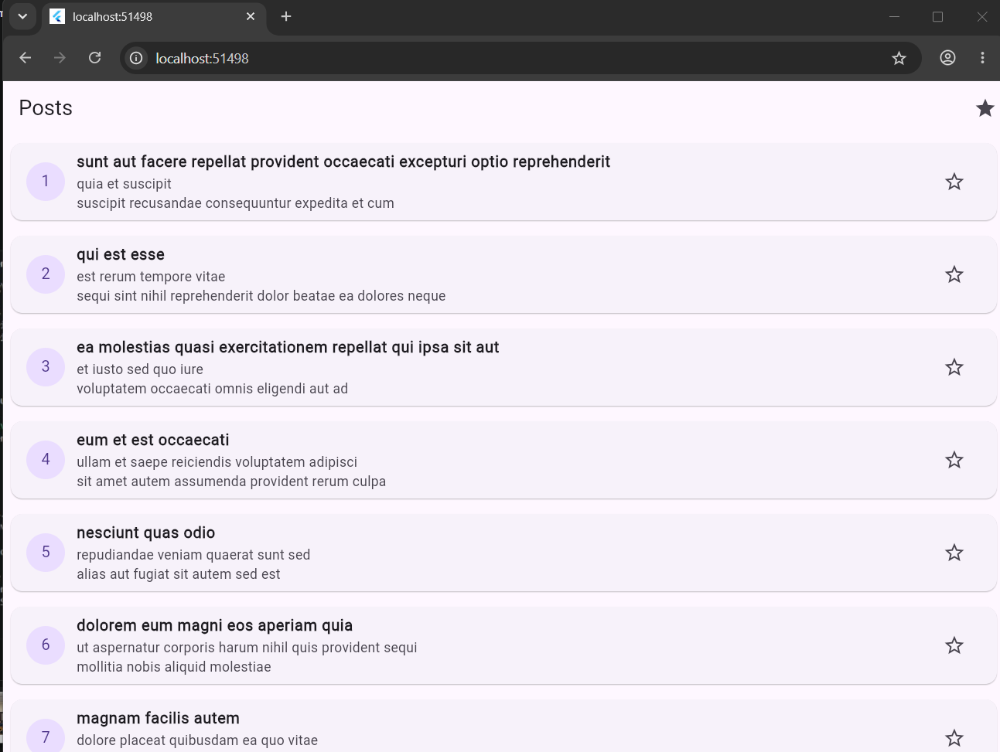
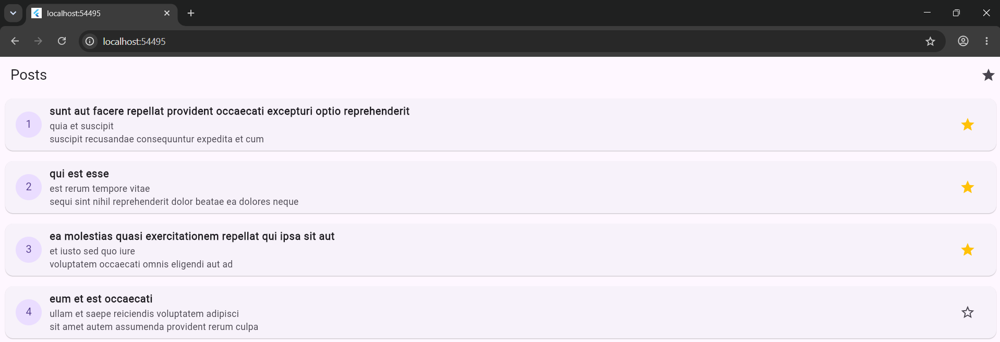
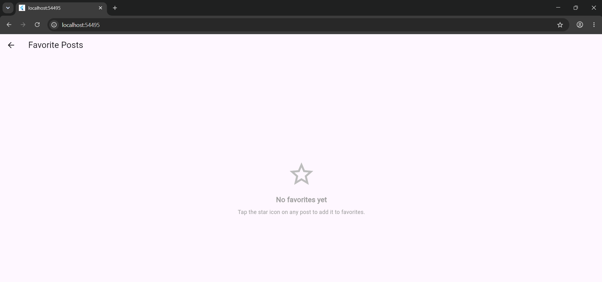
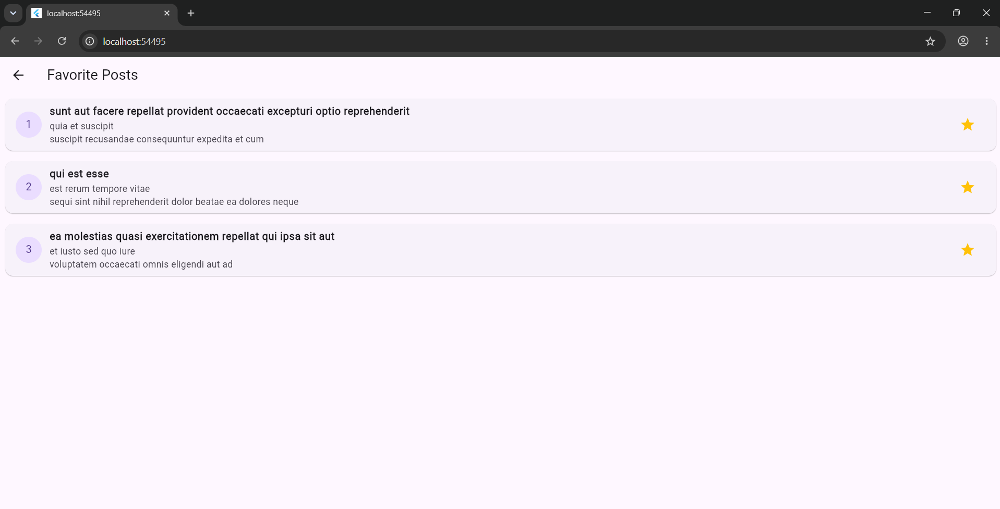
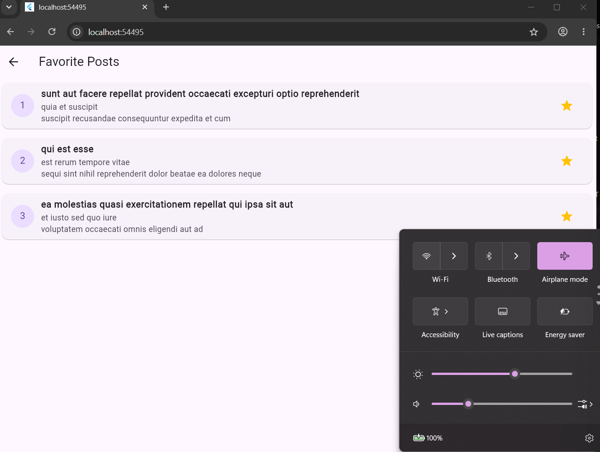

# Mobile Computing - Assignment 5: Hive Local NoSQL Storage

**Course:** Mobile Computing (Fall 2026 | Section 5)  
**Topic:** Hive Local NoSQL Storage, Offline Caching & Favorites Management  

---

## 📱 Project Overview

This Flutter application demonstrates offline-first architecture using **Hive**—a lightweight, blazing-fast, pure-Dart NoSQL database. The app fetches posts from the JSONPlaceholder REST API (`https://jsonplaceholder.typicode.com/posts`), caches them locally into Hive, and enables full offline browsing as well as persistent favorites management.

### Architecture & Data Flow

```
+---------------+      +-------------------+      +-------------------+      +-------------------+
|   INTERNET    | ---> | JSONPlaceholder   | ---> |   Hive NoSQL DB   | ---> |    Flutter UI     |
| (Online Mode) |      | REST API (/posts) |      | ('postsBox')      |      |   (PostsScreen)   |
+---------------+      +-------------------+      +-------------------+      +-------------------+
                                                            |
                                                   [Airplane Mode / Offline]
                                                            |
                                                            v
                                                  Cached Data Returned
```

### Dual-Box Architecture

1. **`postsBox`**:
   - Stores API posts for offline viewing.
   - Cache strategy: Attempt API network request $\rightarrow$ On 200 OK, clear `postsBox`, write latest posts, and return $\rightarrow$ On network failure / offline, fallback to `postsBox.values.toList()`.
   - Prevents stale data accumulation.

2. **`favoritesBox`**:
   - Stores user-favorited posts persistently.
   - Key: `post.id` (integer) for $O(1)$ lookups via `box.containsKey(id)`.
   - Independent Life Cycle: Survives API refreshes and app restarts.
   - **HiveObject Multi-Box Isolation**: Because a single `HiveObject` cannot belong to more than one box at a time, `FavoritesService` stores an independent clone:
     ```dart
     final copy = Post(
       id: post.id,
       title: post.title,
       body: post.body,
       userId: post.userId,
     );
     await _box.put(post.id, copy);
     ```

---

## ✨ Features Implemented

1. **Offline Posts Browsing**:
   - Loads posts online and caches them locally into Hive.
   - Works seamlessly when offline or in airplane mode.
   - Displays clear error if both network and cache are unavailable.
2. **Pull-to-Refresh**:
   - Swiping down triggers API re-fetch and updates the local Hive cache.
3. **Interactive Favorites System**:
   - Outlined star icon (`Icons.star_border`) for unselected posts.
   - Golden filled star icon (`Icons.star`, `Colors.amber`) for favorites.
   - Immediate UI update upon tapping using `ValueListenableBuilder` listening to `Hive.box<Post>('favoritesBox').listenable()`.
4. **Favorites Screen (`FavoritesScreen`)**:
   - Dedicated screen displaying all saved favorite posts with matching card UI.
   - Accessible via the Star button in the `PostsScreen` AppBar.
   - Tap the star on any card to remove it from favorites with instantaneous reactive list update.
   - **Friendly Empty State**: When no favorites exist, displays a clean message: `"No favorites yet"` with instructional text.
5. **Robust Automated Test Suite**:
   - Unit tests for model deserialization (`Post.fromJson`).
   - Unit tests for `FavoritesService` (add, remove, check status, multi-item persistence).
   - Offline fallback verification tests.

---

## 📂 Project Structure

```
lib/
├── main.dart                      # Initializes Hive, registers TypeAdapter, opens boxes, runs app
├── models/
│   ├── post_model.dart            # Post model with @HiveType(typeId: 0) and @HiveField
│   └── post_model.g.dart          # Generated Hive TypeAdapter (PostAdapter)
├── services/
│   ├── post_service.dart          # API fetching + Hive caching fallback logic
│   └── favorites_service.dart     # Favorites business logic (toggle, query, clone copy)
└── screens/
    ├── posts_screen.dart          # Main posts list, pull-to-refresh, star toggles, AppBar action
    └── favorites_screen.dart      # Favorites list with instant reactive updates & empty state
test/
└── widget_test.dart               # Complete automated unit and integration tests
```

---

## 🛠️ Setup & Installation

### Prerequisites
- [Flutter SDK](https://docs.flutter.dev/get-started/install) (v3.13.0 or higher)
- [Dart SDK](https://dart.dev/get-dart)
- Android Studio / VS Code / Flutter CLI

### 1. Clone the Repository
```bash
git clone https://github.com/Fahd-500/Hive-Local-NoSQL-Storage.git
cd Hive-Local-NoSQL-Storage
```

### 2. Install Dependencies
```bash
flutter pub get
```

### 3. Generate TypeAdapter
Run `build_runner` to generate `post_model.g.dart`:
```bash
dart run build_runner build --delete-conflicting-outputs
```

### 4. Run the Tests
Verify all unit tests pass:
```bash
flutter test
```

### 5. Run the Application
Launch the app on your connected device or emulator:
```bash
flutter run
```

---

## 🧪 Step-by-Step Offline & Favorites Verification

Follow these steps to reproduce and verify all assignment criteria:

| Step | Action | Expected Behavior |
|:---:|:---|:---|
| **1** | Run app with internet enabled | Posts load from API; console prints `Loaded from API and cached to Hive: 100`. |
| **2** | Tap star icon on several posts | Icon toggles immediately between outlined (`Icons.star_border`) and filled amber star (`Icons.star`). Posts are saved into `favoritesBox`. |
| **3** | Tap the Star icon in AppBar | Opens `FavoritesScreen` listing all marked favorites with identical card layout. |
| **4** | Remove a favorite | Tap filled star on `FavoritesScreen`; the card disappears immediately. If all are removed, shows `"No favorites yet"`. |
| **5** | Close app & enable Airplane Mode | Re-launch app while offline. |
| **6** | Verify Offline Posts | Posts appear immediately from cache; console prints `Loaded from Hive offline: 100`. |
| **7** | Verify Offline Favorites | Open Favorites screen; previously saved favorites remain intact without internet. |

---

## 📸 Screenshots

| 1. Posts Screen | 2. Toggling Favorites |
|:---:|:---:|
|  |  |

| 3. Empty Favorites Screen | 4. Favorites List Screen |
|:---:|:---:|
|  |  |

| 5. Offline Mode Verification |
|:---:|
|  |

---

## 📋 Submission Checklist

- [x] Hive initialized with `PostAdapter` registered in `main.dart`
- [x] Both `postsBox` and `favoritesBox` opened early
- [x] `PostService` implements API fetch + Hive fallback cache
- [x] `FavoritesService` implements `toggleFavorite(post)`, `isFavorite(id)`, and `getFavorites()`
- [x] Clones `Post` instance to prevent single-box `HiveObject` constraint error
- [x] `PostsScreen` displays dynamic star toggle with immediate UI feedback via `ValueListenableBuilder`
- [x] `PostsScreen` AppBar contains navigation action to `FavoritesScreen`
- [x] `FavoritesScreen` displays list of saved favorites using same card design
- [x] Friendly `"No favorites yet"` message when favorites box is empty
- [x] Comprehensive `README.md` with all feature screenshots and automated unit tests passing 100%
